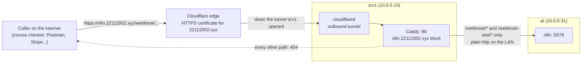

# Public webhooks: reaching n8n from the internet

How a service on the internet calls an n8n webhook on the `ai` VM, which has no public IP and
no open ports, while the n8n editor stays private. Set up and tested on 2026-10-21. The decision
behind it is D16 in [`SYSTEM-DESIGN.md`](SYSTEM-DESIGN.md).

---

## 1. The problem

Until 2026-10-21 n8n was reachable only over the LAN and Tailscale (D5). Every webhook URL it
printed looked like `http://ai:5678/webhook/...`, and `ai` is a name that only exists on the
tailnet. That was fine while every caller was one of our own machines (WAHA, the bridge,
mail-poll). It stopped being fine the first time something on the internet needed to call in:
an n8n course checks your work by sending requests to your webhook from its own servers, and
Postman's web app sends from Postman's servers. Both failed with:

```
Couldn't resolve host. Make sure the domain is publicly accessible
```

The home connection sits behind CGNAT (the ISP shares one public IP across many customers), so
forwarding a port on the router is not an option either.

---

## 2. How it works now

srv1, the other VM on the same Proxmox host, already publishes the owner's websites through a
**Cloudflare Tunnel** and **Caddy**. Webhooks reuse that path. Nothing new runs on `ai`.



| Piece | Where | Job |
|---|---|---|
| DNS record `n8n.22112002.xyz` | Cloudflare | A CNAME to the tunnel, created by `cloudflared tunnel route dns` |
| Tunnel ingress line | srv1 `/etc/cloudflared/config.yml` | Sends that hostname to Caddy on `127.0.0.1:80` |
| Caddy site block | srv1 `/etc/caddy/Caddyfile` | **The filter.** Passes webhook paths to `10.0.0.31:5678`, answers 404 for everything else |
| `WEBHOOK_URL` | `ai`, from `N8N_WEBHOOK_URL` in `/opt/automation/.env` | Makes n8n *print* the public URL on webhook nodes. It does not change what n8n listens on |
| Header Auth on every webhook | n8n, per webhook node | The lock. A call without the right header gets 403 |

**Where the HTTPS comes from.** Cloudflare holds the certificate and encrypts between the caller
and its edge. The tunnel itself is encrypted. From srv1 to `ai` it is plain http on the home
LAN, the same as before. n8n still listens on plain `http://0.0.0.0:5678`.

### What is public and what is not

| Path on `https://n8n.22112002.xyz` | Answer | Why |
|---|---|---|
| `/webhook/<path>` | n8n: 403 without the secret, the workflow's reply with it | Production webhooks of **active** workflows |
| `/webhook-test/<path>` | n8n: 404 unless the editor is listening | Test webhooks: live only after *Listen for test event* |
| `/`, `/signin`, `/home/...`, `/rest/...`, `/api/...`, `/healthz`, `/metrics` | Caddy: 404 | The editor, login, internal and public API stay on Tailscale (`http://ai:5678`) |

---

## 3. The setup, step by step

All srv1 steps run as `srv1`, which has passwordless sudo. Back up both files first.

```bash
ts=$(date +%Y%m%d-%H%M%S)
sudo cp -a /etc/cloudflared/config.yml /etc/cloudflared/config.yml.bak-$ts
sudo cp -a /etc/caddy/Caddyfile /etc/caddy/Caddyfile.bak-$ts
```

### Step 1: DNS (srv1)

```bash
T=$(sudo awk '/^tunnel:/{print $2}' /etc/cloudflared/config.yml)
cloudflared tunnel route dns "$T" n8n.22112002.xyz
# INF Added CNAME n8n.22112002.xyz which will route to this tunnel
```

This uses `~/.cloudflared/cert.pem`, made by `cloudflared tunnel login` when the tunnel was first
set up.

### Step 2: tunnel ingress (srv1)

In `/etc/cloudflared/config.yml`, add the hostname **above** the catch-all; rules are read top
to bottom:

```yaml
  - hostname: n8n.22112002.xyz
    service: http://127.0.0.1:80
  - service: http_status:404
```

### Step 3: Caddy (srv1)

Append to `/etc/caddy/Caddyfile`:

```caddyfile
# n8n on the ai VM (10.0.0.31). Only webhooks are public; the editor, login
# and REST API stay on Tailscale (http://ai:5678). Every webhook checks a
# secret header in n8n itself.
n8n.22112002.xyz:80 {
	@hooks path /webhook/* /webhook-test/*
	handle @hooks {
		reverse_proxy 10.0.0.31:5678
	}
	handle {
		respond 404
	}
}
```

`handle` blocks are mutually exclusive and tried in order, so a request is either proxied or
refused, never both. The Stalwart mail block in the same file hides `/admin` the same way.

### Step 4: validate, then apply (srv1)

```bash
cloudflared tunnel --config /etc/cloudflared/config.yml ingress validate      # OK
cloudflared tunnel --config /etc/cloudflared/config.yml ingress rule \
  https://n8n.22112002.xyz/webhook/x                                          # Matched rule #7
sudo caddy validate --config /etc/caddy/Caddyfile --adapter caddyfile         # Valid configuration
sudo systemctl reload caddy
sudo systemctl restart cloudflared
```

Restarting `cloudflared` takes every site on the tunnel down for about two seconds (Cloudflare
answers 530 meanwhile). Wait for four `Registered tunnel connection` lines in
`journalctl -u cloudflared`, then check the existing sites still answer.

### Step 5: n8n's public URL (`ai`, root)

`stack/.env.example` carries `N8N_WEBHOOK_URL=https://n8n.22112002.xyz/`, and the compose file
passes it on:

```yaml
- WEBHOOK_URL=${N8N_WEBHOOK_URL:-http://${N8N_HOST:-ai}:5678/}
- N8N_PROXY_HOPS=1
```

Re-running `deploy.sh` appends the new variable to the existing `.env` (it never changes values
already there) and recreates n8n:

```bash
wget -qO deploy.sh https://raw.githubusercontent.com/Olwethu-Dlamini/DDOService/main/stack/deploy.sh
sudo bash deploy.sh
```

`N8N_PROXY_HOPS=1` tells n8n that public requests come through one proxy, so it reads the
caller's address from the `X-Forwarded-For` header Caddy adds. Internal callers (WAHA, the
bridge, mail-poll) still use `http://n8n:5678` inside Docker, and are untouched.

---

## 4. Testing

**From any machine, no secrets needed:**

```bash
bash stack/public-webhook-check.sh
```

It passes when the 8 private paths answer 404 and the 3 production webhooks (`work-email`,
`telegram`, `whatsapp`) answer 403 without their header. Result on 2026-10-21, before and after
the n8n redeploy: 11 of 11 ok.

**End to end, with a real caller (the UI test):**

1. In the n8n editor (`http://ai:5678`), open the workflow's Webhook node. The URLs now start with
   `https://n8n.22112002.xyz/`.
2. For a test URL, click **Listen for test event** first. For the production URL, the workflow
   must be active.
3. In Postman (the web app's Cloud Agent works now), send a `POST` with the header from the
   webhook's Header Auth credential: **Headers** tab, Key = the credential's *Name*, Value = its
   *Value*. Or use the **Authorization** tab, type *API Key*, *Add to: Header*.

The n8n course's "Section 2 - Order Webhook Processor" passed its online check this way on
2026-10-21.

---

## 5. Rules for every public webhook

Anything at `/webhook/` is now reachable by anyone on the internet who guesses or learns the path.

1. **Every webhook node uses Header Auth** (or another authentication mode). On 2026-10-21 all 4
   active webhooks did. A webhook with *Authentication: None* is open to the world.
2. **Add new production webhooks to `stack/public-webhook-check.sh`**, so the check proves they
   refuse a call without the secret.
3. **A webhook should answer quickly** and leave slow work (the model, email) to run after its
   reply. The caller waits on an open connection through Cloudflare, which gives up after 100s.
4. **Inactive or test-only workflows leak nothing**: n8n answers 404 for a path it has not
   registered.

---

## 6. Errors met on the way, and what they meant

| What you see | Who said it | Meaning and fix |
|---|---|---|
| `Couldn't resolve host. Make sure the domain is publicly accessible` | Postman Cloud Agent / course checker | The URL uses a name only the tailnet knows (`ai`). Use the public URL; for a quick test, Postman's Desktop Agent sends from your own machine |
| `404` on `https://n8n.22112002.xyz/` | Caddy | Working as intended: only webhook paths are public |
| `404` on `/webhook-test/...` | n8n | The editor is not listening. Click *Listen for test event*, then send within 2 minutes |
| `500 {"message":"No Respond to Webhook node found in the workflow"}` | n8n | The Webhook node is set to *Respond: Using 'Respond to Webhook' node* and the workflow has none. n8n checks this **before** the header, so the 500 says nothing about your secret. Add the node, or set *Respond: Immediately* |
| `403 Authorization data is wrong!` | n8n | The header name or value doesn't match the Header Auth credential. Case matters |
| `500`, and the run in n8n's *Executions* shows `Wrong type: '0' is a number but was expecting a string` | n8n If node | The course sent `"total": 0`, a number, and the If node checked it as a *String* with strict types. Check it as *Number → is not empty* (the fix used), or turn on *Convert types where required* |
| `530` from Cloudflare | Cloudflare | The tunnel is down: srv1 is off, or `cloudflared` is restarting |

To see what a caller actually sent, open the failed run in n8n's *Executions* list (failed runs
are kept for 7 days; successful ones are not stored, see section 5 of the design doc). Or, from
the laptop, with the n8n API key:

```bash
curl -s -H "X-N8N-API-KEY: $(cat ~/.config/ai-n8n-api-key)" \
  "http://ai:5678/api/v1/executions?workflowId=<id>&limit=5"
```

---

## 7. Measured numbers

| What | Value | How | Date |
|---|---|---|---|
| Public webhook round trip from the laptop | median 0.153s (0.132-0.470s, n=10) | `curl -w %{time_total}`, `POST /webhook/whatsapp` without the secret (403), laptop on home internet | 2026-10-21 11:38 SAST |
| Same webhook over Tailscale | median 0.061s (0.053-0.283s, n=10) | Same, to `http://ai:5678` | 2026-10-21 11:38 SAST |
| Extra memory on `ai` | 0 (no new container) | | 2026-10-21 |
| srv1 services carrying it | Caddy 64MB, cloudflared 24MB, both already running for the websites | `systemctl show -p MemoryCurrent` | 2026-10-21 11:38 SAST |

The public path adds about 0.09s, mostly the trip to Cloudflare's Johannesburg edge and back.

---

## 8. Turning it off

- **Stop all public access, keep the URLs:** remove the `n8n.22112002.xyz` block from the
  Caddyfile and reload Caddy. Every public request then gets the tunnel's 404.
- **Go back to Tailscale-only fully:** also remove the tunnel ingress line and restart
  `cloudflared`, delete the DNS record in the Cloudflare dashboard, and set `N8N_WEBHOOK_URL=`
  (empty) in `/opt/automation/.env`, then `sudo bash deploy.sh` on `ai`. n8n prints
  `http://ai:5678/...` again.
- The backups from the setup sit next to each file on srv1 as `*.bak-20261021-095920`.

**Dependency to remember:** public webhooks now need srv1 and the tunnel up as well as `ai`. Both
VMs run on the same Proxmox host, so a host outage already takes both down together.
