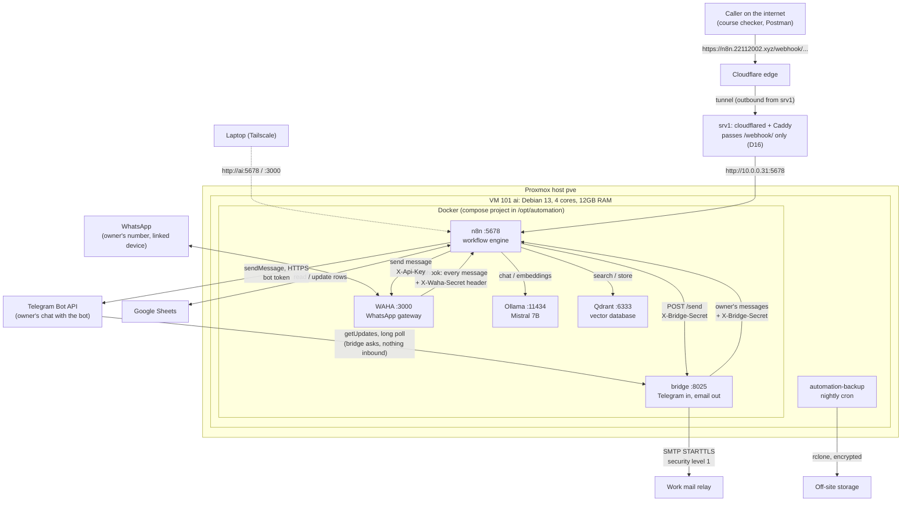
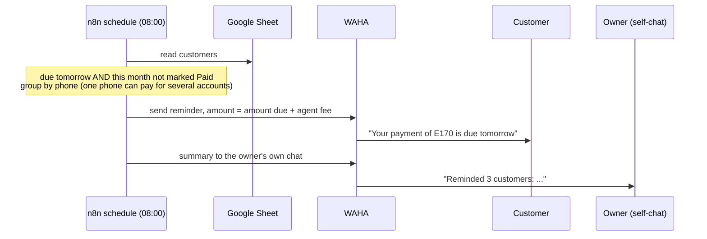

# System design: the `ai` automation server

How the automation server is built, why each piece was chosen, what it costs in memory, and what
went wrong on the way. It is written to teach from: each section explains the idea as well as the
setting.

It is updated with every change to the system, and the git history of this repo is the detailed
record. Business data (customer names, numbers, the spreadsheet itself) never goes in this repo,
which is public.

**Last updated:** 2026-10-21

---

## 1. What the system does

One virtual machine runs **n8n**, a workflow engine, and the services its workflows need: a local
language model, a vector database and a WhatsApp gateway. Workflows built in n8n automate real
work. The first two are:

1. **A RAG chatbot**: answers questions from a private knowledge base (the original
   [`n8n-chatbot`](https://github.com/Olwethu-Dlamini/n8n-chatbot) project, moving onto this server).
2. **A payment-reminder bot for a small subscription-payment business**: reminds customers on
   WhatsApp the day before their payment is due, lets the owner confirm payments by chatting, and
   keeps a Google Sheet up to date.

Many more workflows will follow on the same machine, so **memory is a first-class design concern**
(section 5).

---

## 2. Architecture



### The layers, bottom to top

| Layer | What | Why this layer exists |
|---|---|---|
| Hardware | Proxmox VE host `pve` | Runs several isolated machines on one box; snapshots and whole-VM backups for free |
| Virtual machine | VM 101 `ai`, Debian 13.6 minimal, no desktop | Its own kernel, so Docker behaves normally; can be backed up, moved or rebuilt as one unit |
| Container runtime | Docker + Compose | Each service is one image with its dependencies; the whole stack is one file (`stack/docker-compose.yml`) |
| Services | n8n, WAHA, Ollama, Qdrant | Section 3 |
| Workflows | Built in n8n | Where the actual automation lives |

### Where workflows live

Workflows are stored in **n8n's own database** on the VM, not as files, so nothing on the server
runs `git pull`. They are created and changed in the n8n editor or through n8n's API, and each one
is then exported as JSON and committed to the private `n8n-chatbot` repo, one folder per project
(`dstv/`, `realnet-chatbot/`, `shared/`). Git is their history and their backup.

The stack itself is updated by re-running `stack/deploy.sh`, which fetches the current files from
this repo.

---

## 3. The services

| Service | Job | Port | Reachable from | Auth |
|---|---|---|---|---|
| **n8n** | Runs every workflow: schedules, webhooks, API calls | 5678 | LAN + tailnet; **webhook paths only** also from the internet at `https://n8n.22112002.xyz` (D16) | Owner account (created on first visit); each webhook its own secret header |
| **WAHA** | Turns WhatsApp into an HTTP API: send with a POST, receive as a webhook | 3000 | LAN + tailnet | `X-Api-Key` header; dashboard password |
| **Ollama** | Runs language models locally (Mistral 7B, Q4_K_M) | 11434 | **The VM only** (`127.0.0.1`) | None, which is why it is not published |
| **Qdrant** | Stores text as vectors and finds the closest matches (the "retrieval" in RAG) | 6333 | LAN + tailnet | `api-key` header |
| **mail-poll** | Not a container: a systemd timer on the VM. Every minute it reads a mailbox's new headers over POP3 and posts them to n8n | none | (it only calls out) | Mail password in `/etc/mail-poll.pass` (root only); `X-Mail-Secret` header to n8n |
| **Telegram Bot API** | Not on the VM at all: Telegram's own servers. n8n calls `api.telegram.org` to send the owner a message as a bot; the bridge asks it for the owner's messages | none | (outbound HTTPS only) | The bot token, held as the n8n credential `RI Email`, optionally seeded from `TELEGRAM_BOT_TOKEN` in `.env` |
| **bridge** | `stack/bridge/bridge.py` in the stock Python image, compose profile `telegram`. Long-polls Telegram and posts the owner's messages to n8n; sends email for n8n through the work mail relay (old relays need OpenSSL security level 1, which n8n's Node can't be told to use) | 8025, **not published**: only `http://bridge:8025` inside the Docker network | (it only calls out) | `X-Bridge-Secret` both ways with n8n (`BRIDGE_SECRET`); relay login in `.env` |

Inside Docker the services reach each other **by name** (`http://n8n:5678`, `http://waha:3000`,
`http://ollama:11434`, `http://qdrant:6333`). Compose puts them on one private network with its
own DNS, so no IP address is ever hard-coded.

### Trust boundaries

- **Only n8n's webhooks are exposed to the internet** (D16, since 2026-10-21). The VM itself has
  no public IP and no open port: the home line is behind CGNAT. `https://n8n.22112002.xyz`
  reaches it through the Cloudflare Tunnel that srv1 dials out, and Caddy on srv1 passes on only
  `/webhook/*` and `/webhook-test/*`; every other path, the editor and API included, gets 404.
  The lock on each webhook is its secret header, so **a webhook without authentication is open
  to anyone**. `stack/public-webhook-check.sh` checks both from outside;
  [`PUBLIC-WEBHOOKS.md`](PUBLIC-WEBHOOKS.md) has the rules.
- **Everything else is reached over the LAN** (`10.0.0.31`) or
  [Tailscale](https://tailscale.com) (`ai`, `100.120.56.93`). Tailscale is a private, encrypted
  network between your own devices; SSH over it needs a browser approval per session
  ("Tailscale SSH check").
- **WAHA to n8n**: WAHA adds a secret header (`X-Waha-Secret`) to every webhook. The n8n webhook
  checks it, so a machine on the LAN, or since D16 anyone on the internet, cannot pretend to be
  WhatsApp and fake a "payment received" message.
- **mail-poll to n8n**: the same pattern, with an `X-Mail-Secret` header on
  `/webhook/work-email`. A post without it gets 403 (tested 2026-10-15). The poller runs as a
  throwaway systemd user (`DynamicUser`) and gets the mail password as a systemd credential.
- **n8n to Telegram**: outbound HTTPS to `api.telegram.org`, authenticated by the bot token in
  the URL. Nothing is opened inbound: a bot that only *sends* needs no webhook, so D5 (no public
  ports) holds. Telegram's servers can read bot messages (no end-to-end encryption), which is why
  the work-email alert carries sender and subject only.
- **bridge and n8n**: the same header pattern again, `X-Bridge-Secret`, in both directions. The
  bridge drops any Telegram message that isn't from `OWNER_CHAT_ID` before it reaches n8n, and
  the workflow checks the chat id a second time, so nobody else can make the owner's mailbox send
  an email. The bridge's port is not published, so only containers in the stack can ask it to
  send.
- **Secrets** live only in `/opt/automation/.env` (mode 600), generated by `deploy.sh`. They are
  never committed. The backup copies them, which is why off-site backups are encrypted.

---

## 4. How a message flows

### 4.1 Daily payment reminder (planned, first DStv workflow)



### 4.2 Owner confirms a payment by chatting

The bot runs on the owner's own WhatsApp number, linked to WAHA as an extra device (like WhatsApp
Web). The owner talks to the bot in WhatsApp's **"Message yourself"** chat.

1. The owner writes a command in their self-chat, for example `#paid <customer name>`.
2. WAHA posts it to n8n (event `message.any`, `fromMe: true`, chat = own number).
3. n8n matches the customer in the sheet, asks to confirm, and on `yes` marks the month **Paid**.
4. n8n sends the customer a confirmation.

Commands start with `#`, and the bot's own replies never do. That one rule stops the bot from
reading its own replies as new commands, which would otherwise loop.

### 4.3 Customer messages in

The number is also the owner's personal number, so the bot must **never** auto-reply to friends
or family. It only reacts to messages from numbers that are in the customer sheet, and only to
tell the owner ("<customer> sent a photo, possibly proof of payment"). The owner stays the one who
confirms money arrived: that is the "second guard" on MoMo payments.

---

## 5. Memory budget

The VM has **12GB RAM** and **12GB swap**. Every container has a hard cap (`mem_limit`), so one
misbehaving service is killed and restarted instead of starving the rest.

| Service | Cap | Measured | How measured |
|---|---|---|---|
| Ollama | 6GB | **6.0GB peak** with Mistral loaded (it filled its cap); 13MB of its own when unloaded (2026-10-16) | cgroup `memory.peak` on the VM, 2026-10-07; `memory.stat` anon 2026-10-16 |
| n8n | 1.5GB | 543MB after a day running, 773MB peak; 324MB just after a restart. After 9 days: 429MB of its own, 660MB with cache, 822MB peak | cgroup on the VM, and `docker stats` from `deploy.sh`, 2026-10-07; cgroup `memory.stat`/`memory.peak` 2026-10-16 |
| Qdrant | 1.5GB | 92MB (no collections yet); 55MB of its own on 2026-10-16 | cgroup on the VM, 2026-10-07 and 2026-10-16 |
| WAHA | 768MB | **350MB of its own memory** once linked and synced; the cgroup reads 765MB because 386MB more is disk cache from the sync, which the kernel reclaims (it hit the cap 711 times with 0 OOM kills and 54ms of total stall). Before linking: 408MB on the VM, 300MB on the laptop. Unchanged after 9 days: 355MB own, 763MB with cache, still sitting at the cap | cgroup `memory.stat` (`anon`), `memory.events`, `memory.pressure` on the VM after linking, 2026-10-07; again 2026-10-16 |
| mail-poll | 64MB (`MemoryMax`) | One short Python run a minute; not measured yet | |
| bridge | 128MB | **23MB of its own** on the VM, 27MB with cache, 30MB peak, after its first sends; 24MB as one process on the laptop | cgroup `memory.stat`/`memory.peak` on the VM, 2026-10-16 10:50 |
| Whole VM | 12GB | 1.2GB used in total, containers included, with Mistral unloaded. 1.76GB used after 14 days up, 10GB as reclaimable cache, swap 0, memory pressure 0.00, disk 31GB of 283GB | `free -m` on the VM, 2026-10-07; `free -m`, `/proc/pressure/memory`, `df` 2026-10-16 |

**The rules that keep it inside 12GB:**

1. **The model is loaded on demand.** Mistral alone needs about half the VM. Ollama now unloads it
   after 2 idle minutes (`OLLAMA_KEEP_ALIVE=2m`, default 5m) and keeps at most one model loaded
   (`OLLAMA_MAX_LOADED_MODELS=1`). Workflows that don't use AI never load it.
2. **n8n is one shared process.** Every workflow runs inside it, so its execution history is kept
   small: successful runs are not stored (`EXECUTIONS_DATA_SAVE_ON_SUCCESS=none`), failed runs are
   kept for 7 days, and at most 5 production runs execute at once (the rest queue). Files such as
   photos are written to disk, not held in memory (the n8n 2.x default).
3. **WAHA uses the GOWS engine**, which speaks WhatsApp's protocol directly. The default engine
   runs a full Chromium browser.
4. **Every new service or workflow records its measured cost in the table above** before its cap
   is set.
5. **Measure a service's own memory, not the cgroup's total.** The cgroup counts disk cache too,
   and a busy container fills its cap with cache that the kernel simply reclaims. The number that
   matters is `anon` in `memory.stat`; trouble shows as `oom_kill` in `memory.events` or rising
   `memory.pressure`, not as a full cap. On the VM, as any user:
   ```
   d=/sys/fs/cgroup/system.slice/docker-$(sudo docker inspect -f '{{.Id}}' waha).scope
   grep -E '^(anon|file) ' $d/memory.stat; cat $d/memory.events
   ```

### One shared model

Every workflow that uses AI calls the same Ollama through one n8n credential, `Ollama (local)`.
There is only ever one copy of a model in memory. Two consequences to design around:

- **Requests queue.** Ollama answers one request at a time (`OLLAMA_NUM_PARALLEL=1`). At about 3
  tokens a second, a second workflow can wait minutes. Workflows that must answer quickly should
  not depend on the model.
- **Two models swap.** RAG needs an embedding model as well as the chat model. With
  `OLLAMA_MAX_LOADED_MODELS=1`, every question would unload Mistral to embed, then reload it (48s).
  When the RAG chatbot moves here, raise it to 2 and measure the embedding model's memory first.

Planned: a watchdog workflow that messages the owner when any service passes 85% of its cap.

---

## 6. Decision log

Each decision records what was chosen, what it was chosen over, and why. When a decision changes,
add a new entry rather than editing the old one.

| # | Date | Decision | Over | Why |
|---|---|---|---|---|
| D1 | 2026-10-01 | Run Docker in a **VM** | An LXC container | Docker inside LXC needs nesting and privileges and breaks in subtle ways; a VM has its own kernel |
| D2 | 2026-10-01 | **Debian 13.6** minimal, no desktop | The guide's Debian 12 | 13 is the current stable; a desktop wastes RAM on a server nobody looks at |
| D3 | 2026-10-01 | **Mistral 7B Q4_K_M** in Ollama | Cloud LLMs | Free and private. Trade-off: slow on CPU (section 8) |
| D4 | 2026-10-01 | **Qdrant** for vectors | Chroma, pgvector | Fast, small, has snapshots and a dashboard |
| D5 | 2026-10-01 | **Tailscale**, no public ports | Port forwarding, ngrok | Nothing on the internet can reach the VM |
| D6 | 2026-10-02 | Backups: **Qdrant snapshots + n8n export + rclone**, encrypted | The guide's `tar` of live files | Copying a database while it writes can produce a broken backup; rclone reaches Google Drive or self-hosted storage |
| D7 | 2026-10-07 | **WAHA** (GOWS engine) as the WhatsApp gateway | Evolution API | One container, no Postgres or Redis; Apache-2.0, every feature free since 2026.6.1. Same unofficial-protocol ban risk as Evolution |
| D8 | 2026-10-07 | **Google Sheets** for the payment data | Baserow, NocoDB, the Excel file | The owner edits it from a phone; uses no VM memory (Baserow needs at least 2GB) |
| D9 | 2026-10-07 | **No AI** in the payment bot's first version | An AI agent | The job is a schedule and a table; rules are instant and predictable, Mistral takes minutes |
| D10 | 2026-10-07 | Bot runs on the **owner's own number** | A dedicated number | Customers already know it. Risk accepted: WhatsApp can ban numbers that automate |
| D11 | 2026-10-15 | New work email reaches n8n through **mail-poll** (POP3, systemd timer, webhook) | n8n's IMAP trigger; scraping webmail | The trigger never saw new mail on the old work server (build log). POP3 is what the mail client already uses there; webmail scraping breaks when the page changes |
| D12 | 2026-10-16 | Owner-only notifications go out through a **Telegram bot**, starting with the work-email alerts | WhatsApp through WAHA (as before); a second WhatsApp number | Every automated message from the owner's personal number adds to the D10 ban risk, and own-number WhatsApp messages don't ring. Telegram's Bot API is official, free, sends over outbound HTTPS (no public URL, D5 intact) and a bot's message rings. WAHA stays for the customer-facing DStv bot |
| D13 | 2026-10-16 | The owner's Telegram messages reach n8n through the **bridge** (long polling), and email is **sent by the bridge**, not by n8n | Tailscale Funnel + n8n's Telegram Trigger; n8n's Send Email node; a mail app on the phone (offered, declined) | Long polling keeps D5 (no public URL). The work relay's 1024-bit TLS key is refused by Node (`ERR_SSL_DH_KEY_TOO_SMALL`, Node 26) and n8n's Send Email node can't set `In-Reply-To`, so replies wouldn't thread; a Python sender does both in 300 lines, about 25MB |
| D14 | 2026-10-16 | The bridge **Bcc's the sender** on every email it sends (`MAIL_COPY_TO`, default `self`) | Append to an IMAP Sent folder; a sent log on the VM; switch the mail client to IMAP | SMTP keeps no copy, and the owner's client reads the account over POP3, which has no server folders. A Bcc reaches the mailbox and the client within a minute, needs no new part, and the client files it to Sent with one filter. The alert workflow skips these copies by the `.bridge` mark in their Message-ID |
| D15 | 2026-10-20 | A reply typed in Telegram is a **reply-all**; `/reply` answers the sender only | Sender only (as before); sender only with a command for everyone | The owner's choice: replies were leaving the others on the thread out. The workflow lists To + Cc minus the owner and the sender; the bridge drops the sender's own address and anyone already in To from Cc as a guard and answers with the recipients it used, so the Telegram confirmation names them. Bcc recipients of the original can't be included: a received email doesn't carry them |
| D16 | 2026-10-21 | n8n's **webhooks** (`/webhook/`, `/webhook-test/`) are public at `https://n8n.22112002.xyz`, through the **Cloudflare Tunnel and Caddy already running on srv1**; the editor, login and API stay on Tailscale. Updates D5 | Keep D5 (Tailscale only); Tailscale Funnel; a `cloudflared` container on `ai`; publishing the whole n8n | Callers on the internet (an n8n course's checker, Postman's web app) could not resolve `ai`. The owner's own domain was wanted, which Funnel can't give (`*.ts.net` only). srv1 already holds a tunnel and Caddy for the owner's websites, so this costs `ai` no memory and follows the series' pattern: Caddy filters paths, as it hides Stalwart's `/admin`. Every webhook keeps its secret header (403 without it). Trade-off: public webhooks also need srv1 up. Guide: [`PUBLIC-WEBHOOKS.md`](PUBLIC-WEBHOOKS.md) |

---

## 7. Build log: what happened and what went wrong

| Date | Step | What went wrong | Fix and lesson |
|---|---|---|---|
| 2026-10-01 | Created VM 101 in Proxmox (4 cores, 12GB, ballooning off, 300GB VirtIO SCSI, guest agent on) | No Debian ISO on the laptop | Downloaded `debian-13.6.0-amd64-netinst.iso` to the Proxmox ISO storage |
| 2026-10-01 | Debian install | Pressed Enter on *Software selection* with the GNOME desktop still ticked; the installer started downloading a desktop | Stopped the VM and ran the installer again; the disk now came first in the boot order, so reaching the ISO needed **Esc** at boot for the boot menu. **Lesson:** on that screen, untick the desktop *before* pressing Enter |
| 2026-10-01 | First boot | Stuck at "Booting from Hard disk..." | GRUB (the boot loader) was not on the disk, and the installer's *Reinstall GRUB* failed with exit code 1. Booted the ISO's rescue mode, opened a shell in `/dev/sda1`, ran `grub-install /dev/sda` and `update-grub`. **Lesson:** GRUB goes on the whole disk (`/dev/sda`), never a partition (`/dev/sda1`) |
| 2026-10-01 | Post-install (`post-install.sh`) | Copy-paste into the Proxmox web console doesn't work | Put every step in a script in this public repo and ran `wget -qO- <raw URL> \| bash` |
| 2026-10-01 | Post-install | The guide's `sysctl -p` fails: Debian 13 has no `/etc/sysctl.conf` | Settings go in `/etc/sysctl.d/99-automation.conf` |
| 2026-10-01 | Script download | The first copy was in a private repo, so `wget` on the VM got nothing | Moved scripts to this public repo; secrets never go in it |
| 2026-10-01 | Stack deploy | The guide's compose file had five errors: a healthcheck using `curl` (not in the Qdrant image), a config file it never creates, the wrong Qdrant key variable, n8n basic auth (removed in n8n 1.0), `WEBHOOK_TUNNEL_URL` (renamed `WEBHOOK_URL`) | Corrected in `stack/docker-compose.yml`; the header lists each fix. **Lesson:** check a guide's config against the current image's docs |
| 2026-10-02 | Checking the stack | `docker: command not found` | The commands ran on the Proxmox host (`root@pve`), not the VM (`root@ai`). **Lesson:** read the prompt before running anything |
| 2026-10-02 | Backups | The guide's script compressed twice, copied live database files, used an uninstalled `mail` | Rewrote as `backup/backup.sh`, tested snapshot and restore on the laptop |
| 2026-10-07 | WhatsApp | Evolution API needs Postgres and a cache: 3 containers for one job | Switched to WAHA (D7), verified on the laptop that its webhook carries the secret header |
| 2026-10-07 | First deploy with WAHA | `deploy.sh` printed `WAHA: NOT OK` | WAHA was fine; the check ran before it finished starting. Added a wait. **Lesson:** a health check needs a wait loop, or it reports a race as a failure |
| 2026-10-07 | n8n credentials | The script's hidden key prompt got 401 although the key worked | Nothing was visible while pasting, so a paste carrying terminal codes or nothing at all looked fine. The script now strips paste codes and spaces and prints the key's length and last 6 characters. **Lesson:** a silent prompt must confirm what it received |
| 2026-10-07 | Linking WhatsApp | Long commands pasted into SSH broke: the terminal wrapped lines inside quotes, dropped a space (`-qO-https://...`), and added `^[[200~` paste codes | Put the steps in a script (`stack/whatsapp-link.sh`) and ran it as `wget <url>` then `sudo bash <file>`. **Lesson:** anything longer than one short line goes in a script, not a paste |
| 2026-10-07 | Linking WhatsApp | The WAHA dashboard's worker loaded forever ("please connect a server first") | Reproduced in headless Chromium: the dashboard stores its servers in the browser's `localStorage`, and its built-in server uses the key `admin`, so WAHA answered 401. Writing the real key into `localStorage` fixed it. The phone was linked without the dashboard, by pairing code |
| 2026-10-07 | First message through the router | The owner's self-chat message was ignored | WhatsApp gives each account a hidden id (`...@lid`) besides the phone number. In the self-chat, WAHA's GOWS engine sends `to: null` and names the chat only in `_data.Info.Chat`, by that hidden id. The router now matches either id. **Lesson:** build parsing against a real captured payload, not the docs' example |
| 2026-10-15 | Work email alerts | n8n's IMAP trigger connected (credential test passed) but never fired: a test email sat in the mailbox, and after 4 minutes, then after reconnecting every minute, there was no run, no error and no stored UID | The server (IMail 8.22) has no IMAP IDLE, so n8n's IMAP library falls back to polling, and this server evidently doesn't report new mail to it. Read the same mailbox over POP3 instead with `mail-poll/`, tested against the real mailbox from the laptop first. **Lesson:** an old mail server is best read the way its users' mail clients already read it |
| 2026-10-16 | Work email alerts | The owner asked to move the alerts off WhatsApp: a ban on the personal number would take the DStv business bot down with it, and own-number alerts arrived silently | New n8n workflow with a Telegram node on the same webhook path, so the poller on the VM wasn't touched; the old workflow switched off, not deleted, for a one-command rollback. `n8n-credentials.sh` learnt an optional `TELEGRAM_BOT_TOKEN`. Guides in the private repo's `work-email/`. **Lesson:** keep the trigger and the sender in separate nodes, so a channel can be swapped without touching the half that needed root to install |
| 2026-10-16 | Replying from Telegram | Sending through the work relay failed from both Python (`DH_KEY_TOO_SMALL`) and Node (`ERR_SSL_DH_KEY_TOO_SMALL`): its STARTTLS uses a 1024-bit DH key, and its certificate chain carries expired intermediates | `openssl s_client -cipher 'DEFAULT:@SECLEVEL=1'` worked, so the bridge sets that level on its one SMTP connection and can be told to skip chain verification. n8n's own Send Email node has no such switch, and can't set `In-Reply-To` either, which decided D13. Tested end to end with the bridge on the laptop in dry-run mode before any root step on the VM. **Lesson:** an old relay is a reason to own the sending code, not to weaken the whole container's TLS |
| 2026-10-16 | Bridge on the VM | First real reply from Telegram: `535 Authentication failed`, although the same password typed again passed a login test. The first paste of the relay password into the setup script carried a hidden carriage return; the helper that wrote `.env` kept it, and later rewrites split the line at it, leaving a stray `'` line. Compose refused the file (`unexpected character "'" in variable name`), so the container was never recreated and kept a one-character password | Deleted the stray line, `up -d --force-recreate bridge`, login OK, email delivered and threaded. Added `stack/bridge/relay-test.sh`, which tests the login the container actually holds and prints only the password's length and first/last character. **Lesson:** strip `\r` from anything read at a prompt, and make the test read the running container's settings, not the typed value |
| 2026-10-21 | Public webhooks (D16) | An n8n course's checker and Postman's web app could not call a webhook: `Couldn't resolve host`, because `http://ai:5678` only exists on the tailnet. Once public, the course got 500 twice: first `No Respond to Webhook node found in the workflow` (n8n checks this before the secret header, so it said nothing about auth), then the If node's `Wrong type: '0' is a number but was expecting a string`, because the checker sent `"total": 0` and the node compared it as a string with strict types. A long `wget` URL pasted into SSH arrived without the URL | Reused srv1's tunnel and Caddy instead of a new container on `ai`: DNS record, one ingress line, a Caddy block that passes `/webhook/*` only, then `WEBHOOK_URL` on `ai`. Validated both configs before restarting; the restart gave the existing sites about two seconds of 530. `stack/public-webhook-check.sh` proves from outside that the editor is hidden and every webhook needs its secret. The failing course runs were read from n8n's *Executions* through the API, which showed the exact body and error. The course passed the same day. **Lesson:** a public URL only gets the request to the door; read the failed execution to see what happened inside |

---

## 8. Measured numbers

Each figure states what was measured, where, and when.

| What | Value | Where / how | Date |
|---|---|---|---|
| Mistral 7B write speed | 56 tokens in 18.4s, **about 3 tokens/s** | Ollama API on the VM, one short prompt | 2026-10-07 |
| Mistral 7B read speed | 41 tokens in 2.5s, about 16 tokens/s | Same request | 2026-10-07 |
| Mistral cold load | 48.1s | Same request, model not in memory | 2026-10-07 |
| Estimated RAG chatbot reply | 1.5-3 minutes | **Estimate, not measured**: ~1,500 tokens read + an agent that calls the model twice | 2026-10-07 |
| WAHA memory | 300MB laptop / 408MB VM | `docker stats`; laptop with a session waiting for a QR code, VM with no session | 2026-10-07 |
| Public webhook round trip | median 0.153s (0.132-0.470s, n=10) via `https://n8n.22112002.xyz`; median 0.061s (0.053-0.283s, n=10) over Tailscale | `curl -w %{time_total}` from the laptop, `POST /webhook/whatsapp` without the secret (403); Cloudflare edge JNB | 2026-10-21 11:38 SAST |
| Memory for public webhooks | 0 on `ai` (no new container); on srv1 Caddy 64MB and cloudflared 24MB, both already running for the websites | `systemctl show -p MemoryCurrent` on srv1 | 2026-10-21 11:38 SAST |

---

## 9. Glossary

| Term | Meaning |
|---|---|
| **RAG** | Retrieval-Augmented Generation: search a knowledge base first, then let the model answer using only what was found |
| **Embedding** | A list of numbers that represents the meaning of a piece of text; similar meanings give nearby numbers |
| **Vector database** | Stores embeddings and finds the nearest ones to a question (Qdrant) |
| **Webhook** | A URL one system calls to tell another that something happened (WAHA calls n8n when a message arrives) |
| **Container** | A packaged program with its dependencies, isolated from the others (Docker) |
| **cgroup / `mem_limit`** | The Linux kernel feature Docker uses to cap a container's memory; past the cap the container is killed and restarted |
| **Quantization (Q4_K_M)** | Storing a model's weights in 4 bits instead of 16, so a 7B model fits in about 4.4GB |
| **Keep-alive** | How long Ollama keeps a model in RAM after its last request |
| **Linked device** | A second device using your WhatsApp number (like WhatsApp Web); WAHA is one |
| **CGNAT** | Carrier-grade NAT: the ISP shares one public IP across many homes, so nothing on the internet can open a connection to a home machine, and port forwarding can't help |
| **Cloudflare Tunnel** | `cloudflared` on srv1 opens an outbound connection to Cloudflare and keeps it open; Cloudflare sends visitors of the domain back down it. Works behind CGNAT |
| **Reverse proxy** | A server that receives requests and forwards them to another one, choosing by hostname and path (Caddy on srv1). It is where public webhooks are filtered |
| **`WEBHOOK_URL`** | The address n8n prints on webhook nodes. It changes the URL n8n shows, not what n8n listens on |

---

## 10. Open items

- **Choose where the payment data lives** (D8 is being reconsidered: the Google Cloud setup is a hurdle). Options, measured: [`DATA-STORE-OPTIONS.md`](DATA-STORE-OPTIONS.md).
- Build the payment-reminder workflows (section 4); designed in the private repo's `dstv/README.md`.
- Run the backup on the VM and choose off-site storage.
- Watchdog workflow for memory (section 5).
- Measure mail-poll's memory and runtime on the VM (section 5).
- Bridge with D14 and D15 deployed on the VM 2026-10-20. Still to do: the owner's phone test of
  reply-all and the Sent copy, and the mail client's filter if missing (private repo,
  `work-email/SETUP.md` 5f, and `work-email/reply-all/README.md`).
- The owner's call: delete the WhatsApp alert workflow and the unused `RI Work` credential;
  revoke and replace the bot token that was pasted into a chat on 2026-10-16.
